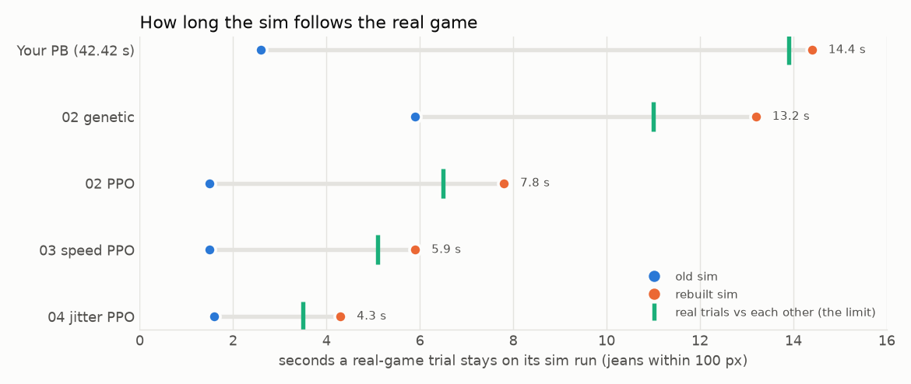
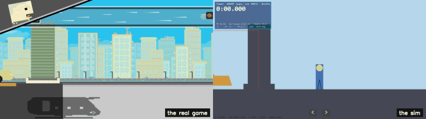
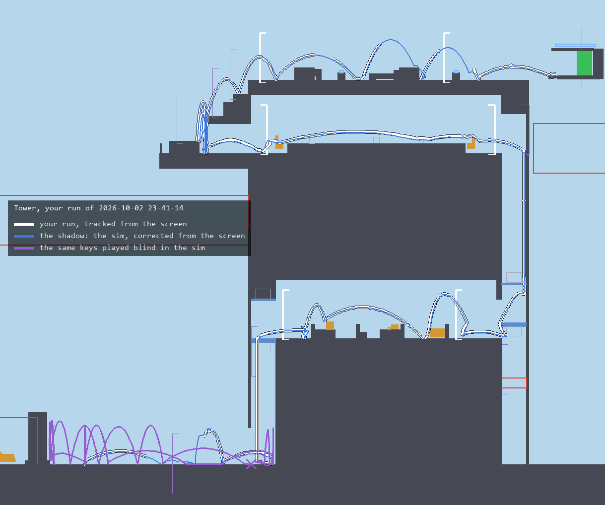
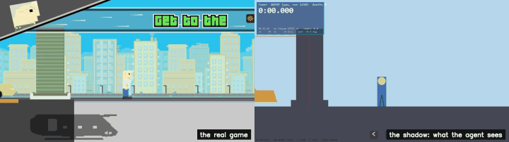

# Getaway Shootout speedrun AI

A faithful copy of Getaway Shootout's speedrun mode, and two AIs learning to play it: one by
reinforcement learning (PPO), one by evolution (a genetic algorithm). Both are written in PyTorch.

- **Maps:** the real Street, Train, Town and Tower maps, pulled straight out of the original 2019 game build (`tools/extract_maps.py` → `sim/maps/*.json`).
- **Physics:** Box2D, the same engine Unity's 2D physics runs on, with the shipped game's settings (50 Hz, gravity −9.81, 8/3 iterations). Rebuilt on 2026-10-20 from real-game trials played by script: it now follows the real game as long as the game repeats itself (see "In the real game").
- **Player:** a line-by-line port of `PlayerMovement.cs` from the developer's tutorial project. You **hold** a direction to lean, then **release** to jump along your body. Body size and mass are the 2019 build's stored values; the lean is measured from a recording of the current game.
- **Stripped out:** weapons, power-ups, bots and menus. It's one player racing to the getaway vehicle.

## Layout

```
sim/       the simulation only: world.py (physics), env.py (what the AI sees and is rewarded for), play.py (viewer), maps/
ppo/       method 1: reinforcement learning (PPO), in PyTorch
genetic/   method 2: a genetic algorithm, in PyTorch
common/    what both methods share so the comparison is fair: the network, the parallel workers, the chart
tools/     extracts the maps and renders the level art from the original game file (not included: see below)
real/      plays trained agents in the real game: blind replays, trials, and closed loop (locate, shadow, live, clip)
runs/      one folder per training batch (runs/01-from-the-start/, ...), plus your best times (pb_<Map>.json)
```

Each batch folder holds everything that batch made: the best agents, snapshots, checkpoints, logs, raw data, the
chart, and the copy of your best run it practised from (`your_run.json`). The batches are defined in `BATCHES` in
`common/workers.py`; add a new one at the end to try something else, and record it in `EXPERIMENTS.md`.

Run everything from this folder.

Not in the repository: the original 2019 WebGL build of the game (`tools/GetawayShootoutPoki.data.unityweb`,
only needed to extract the maps or render the level art again; what they made is in `sim/maps/`), and the films
of real-game runs (`*.mp4`, too big for GitHub; the GIFs below are made from them).

## Play / watch

```bash
py -m sim.play --map Tower                    # A/W/← left, D/E/→ right. Hold = lean, release = jump. Z zooms out
py -m sim.play --map Tower --overlay          # Tab: the model's-eye view (rays + all 53 inputs)
py -m sim.play --agent runs/03-speed/ppo_tower.pt          # watch a trained agent
py -m sim.play --agent runs/02-your-run/genetic_tower.pt
py -m sim.play --agent runs/01-from-the-start/ppo_tower.pt runs/02-your-run/ppo_tower_run.json runs/03-speed/ppo_tower.pt
py -m sim.play --race                         # the last batch's best agents racing on one screen: PPO blue, genetic red
py -m sim.play --race --loop                  # keep racing, reloading each agent whenever training saves a better one
```

`--agent` also takes an agent's recorded run (`.json`), played back key for key; the sim is exact, so it plays out
just as the agent did. Batch 02's PPO agent only exists that way now (`runs/02-your-run/ppo_tower_run.json`, 32.84 s):
its network was overwritten on 2026-10-20.

## Train: PPO vs a genetic algorithm

Both methods train the same PyTorch network (`common/policy.py`: 53 inputs -> 64 -> 64 -> 3 actions) on Tower,
with the same inputs and the same reward. Only the way they learn differs: PPO (reinforcement learning) improves
one network from reward signals; the genetic algorithm keeps the best 16 of 128 networks, mutates them, repeats.

The experiment is three batches, each trained with both methods for 50 million sim steps, plus more for playing in
the real game (see the end):

| Batch | Practice from your run | Reward | Saves |
|---|---|---|---|
| `01-from-the-start` | off: every episode starts at the start | normal | highest reward |
| `02-your-run` | half the practice episodes start at a moment of your best run | normal | highest reward |
| `03-speed` | PPO: on. Genetic: whichever of 01 / 02 gave it the faster time | the finish pays +1 for every second left on the clock | fastest |
| `04-jitter` | on, as 02, with each key change landing 0-3 ticks late in practice (as in the real game) | normal | highest reward |
| `05-shadow` | as 04, and nudged every 2 ticks like the shadow the agent plays from in the real game; sees the lifts move (PPO only) | normal | highest reward |
| `06-shadow-genetic` | as 05 for the genetic algorithm: each member ranked on 4 runs with late keys and nudges (120M steps) | normal | highest reward |
| `07-helicopter` | as 05, in the sim with the helicopter where the game has it (not trained yet) | normal | highest reward |

```bash
py -m common.run_batches                  # train them all, one after another (about 8 h; leave it overnight)
py -m common.run_batches 03-speed         # just one
py -m common.compare 02-your-run          # redraw a batch's chart -> runs/02-your-run/compare.png
py -m common.compare --all                # every batch on one chart -> runs/compare_all.png
```

Each batch and what it did to the times goes in `EXPERIMENTS.md`.

Watch training while it runs, each in its own terminal:

```bash
py -m common.compare 01-from-the-start --live                      # the chart in a window, redrawn every 5 s
py -m sim.play --agent runs/01-from-the-start/ppo_tower.pt --loop   # the best agent so far, picking up each new one
```

- **You don't have to keep it running.** Each trainer saves the best agent so far (`ppo_tower.pt`,
  `genetic_tower.pt`), a full checkpoint every two minutes, and a progress log, all in the batch's folder. Stop
  with Ctrl+C; `py -m common.run_batches` again carries on where it stopped. To train a batch again from
  scratch, delete its folder first. (`py -m ppo.train` and `py -m genetic.train` on their own train the last
  batch, or the one `GETAWAY_BATCH` names. Without `--resume` they refuse to start over a batch that already has
  training, unless you add `--fresh`: a test run once overwrote batch 02's PPO agent that way, see EXPERIMENTS.md.)
- **Keeping the PC awake:** training stops Windows from going to sleep while it runs (a sleep pauses it), and
  from slowing it down as a background job ("efficiency mode" halved the speed when it was started from a window
  that wasn't in front). Closing a laptop's lid still sleeps.
- **Logs:** `ppo_log.csv` has every PPO test run, `genetic_log.csv` each generation's best. Every row has the
  run's `reward` and where it came from (`reward_progress`, `reward_time`, `reward_deaths`, `reward_finish`,
  `reward_stall`, which add up to it), plus how far it got, its time and deaths.
- **Raw data, for graphs:** `ppo_episodes.csv` has every PPO practice episode and where in your run it started
  (`start_s`, 0 = from the start); `genetic_population.csv` has every member of every generation, the member it
  was bred from, and its practice from your run (`practice_start_s`, `practice_reward`). Same columns otherwise.
- **Saved agents** (`.pt` files) hold the network's 7,811 weights plus a note of how the agent did (time, deaths,
  steps trained). Each new best overwrites the file, so it always holds the best agent of the batch. "Best" is
  set per batch (`save_by` in `BATCHES`): highest reward, or fastest to the getaway.
- **Snapshots:** `SNAPSHOTS` in `common/workers.py` (now every power of 10: 1, 10, 100, 1000, ...) also keeps the
  agent from those test runs (PPO) or generations (genetic) as `ppo_run10.pt` etc. Race them to show learning:
  `py -m sim.play --agent runs/<batch>/ppo_run1.pt runs/<batch>/ppo_run10.pt runs/<batch>/ppo_run100.pt`
- **Inputs (53 numbers):** velocity, lean, turning state, the next 3 checkpoint lines, 16 distance rays
  (with "is it deadly"), the episode time, and the nearest lift's height and speed.
- **Actions:** release, hold left, hold right, decided 25 times a second.
- **Reward:** +0.1 per 112 px of route progress, −0.1 per second, +10 at the finish, −1 per death. Batch
  `03-speed` also pays +1 at the finish for every second left on the 90 s clock, so a second saved is worth 1.1
  instead of 0.1 (`rewards` in `BATCHES`; the viewer shows an agent's reward with the same settings).
- **Training-only rule:** an episode ends as a failure (−5) if there has been no progress for 20 s, so freezing
  in place is never a safe option. That is longer than the slowest lift's full cycle (15.3 s), so waiting for a
  lift is never punished.
- **Practice from your run** (`practice` in `BATCHES`): half the episodes the methods learn from start at a
  random moment of your best run (restored exactly as it was: see "In the real game"), not at the start. A batch copies `runs/pb_Tower.json` into
  its folder (`your_run.json`) when it starts, so setting a new best while it trains changes nothing. PPO starts
  each practice episode there at a coin flip; each genetic member plays once from the start and once from a
  moment shared by its generation, and is ranked on both rewards added up. Why: in earlier tests PPO stalled at
  73%. The roof climb needs a short tap from the top of a block up onto the ledge, which random play finds
  13-32% of the time from there, but an agent that has learned to hold its lean never tries.
- **Scoring:** an agent is scored by one test run where it always plays its top-rated action. The sim has no
  randomness, so the same agent always gets the same result. The line to beat is your best time in the sim
  (the batch's `your_run.json`, from `runs/pb_Tower.json`, which `sim.play` saves when you play).
- Speed on 8 cores: about 14k sim steps/s for PPO and 17k for the genetic algorithm. No GPU needed.

## In the real game

```bash
py -m real.replay runs/03-speed/ppo_tower.pt           # the agent's sim key presses, played into the real game
py -m real.replay runs/03-speed/ppo_tower.pt --watch   # only check that the start is spotted
```

Open the real game's Tower speedrun full screen, run the command, click into the game and start a run. The script
watches the screen for the drop-in landing; the game takes keys from 0.16 s after it (`CLOCK_AFTER_LANDING` in
`real/replay.py`), and acts on each key about 0.04 s after it is sent, so every press goes that much early
(`KEY_LEAD`). X stops it; the drop-in has to be on screen, so start the run after the game is full screen. This is
open loop: the agent can't see the real game, so any difference between the sim and the game grows, and the run
goes its own way. `--offset 0.03` shifts every press later (negative: earlier).

### Measuring it: many trials, no one at the keyboard

```bash
py -m real.trials runs/03-speed/ppo_tower.pt runs/pb_Tower.json --trials 8   # trials in turn; X stops
py -m real.trials_report "real/trials/<date time>"     # how long each trial stayed on its sim run
py -m real.physics_check "real/trials/<date time>" --variants base com=0.4   # the sim, changed, against the trials
py -m real.robustness runs/03-speed/ppo_tower.pt       # blind replays with timing errors, in the sim
```

Set up first: the Tower time trial (Play, Time Trial, Tower, Next, Standard Steve, Play), full screen with the
CrazyGames bar hidden, in a run. `real.trials` then does everything itself: it brings the game's window to the front,
restarts the run from the pause menu, waits for the drop-in, plays the run's keys and records where Steve's jeans
and head are on the screen (~30 times a second), round after round, saving the exact keys with each trial. It only
ever presses keys or clicks while the game is the window in front, and Windows mustn't lock the screen meanwhile
(that stops it). `real.trials_report` films the sim run of the same keys with the game's camera (fitted to each
trial's first second) and finds when the real jeans first end up over 100 px from where the sim has them. It also
compares the trials of a run with each other: the real game is repeatable, so that is the most any sim could match.
Probes (`real/probes/`) are short key sequences played like a run, for questions about one move;
`real.body` reads Steve's body angle from his head and jeans.

**The sim, rebuilt from the real game (2026-10-20).** About 140 real-game trials, played by the scripts above, showed where
the sim and the game part ways; each fix below was tested against all of them with `real.physics_check`:

- **The start and the keys:** the game takes keys 0.16 s after the drop-in landing, not 0.04 s, and acts on a
  key 0.04 s after it is sent. (Replay timing, not physics: `real/replay.py`.)
- **A jump leaves the ground at once:** switching keys at the jump (release one, press the other in the same frame)
  started a lean in the air in the sim, which locked the body's rotation and swung it 56 deg the other way. In the
  game the body just eases back upright, like any jump (`Movement.jump_leaves_ground`).
- **The centre of mass is low:** landing tilted, the real Steve rocks back for a tenth of a second before tipping
  forward; the sim's, with the weight in the middle of the box, tipped forward at once. A centre of mass 0.3 of his
  height up fits the trials best (0.2-0.33 nearly as well; `Movement.centre_of_mass`).
- **The lifts carry you:** in the game you stay on the floor when a lift stops; the sim's lift, moved by velocity,
  threw you into a 0.4 s hop. The lifts now move by position and carry whoever stands on them, and run 0.3 s later
  in their cycle than measured before (`Movement.lift_carries`, `ELEVATOR_HEAD_START`).



With these, a real-game trial of your PB stays on its sim run for 14 s (it was 2.6 s), and batch 02's genetic run
for 13 s (5.9 s): as long as two real trials of them stay with each other. The PPO runs, which re-jump the instant
they land, go 4-8 s, also about as long as their own real trials agree. Last night's explanation (that the game aims
a jump just after landing along a fresh lean) was a symptom of the first two: in the game the body had already
eased back upright in the air.

The old agents (`runs/old-physics-2026-10-19/`) were trained on the old sim, and most no longer finish in this one;
the batches are retrained on it. Your PB (`runs/pb_Tower.json`, 42.42 s) was played in the old sim too: its keys
replayed in the new one only get halfway, so practice now starts from the moments of your run instead (where you
were, how fast, which key you held, the lifts and furniture), recorded by replaying it under the old physics
(`OLD_MOVEMENT` in `sim/world.py`; `Game.snapshot` / `Game.restore`).

```bash
py -m real.record      # record the screen + your W / E presses to real/recordings/<date time>/ (X stops)
```

## Checked against the real game

All distances and speeds are in the real game's screen pixels with the game window 1920 wide (the viewer's
readouts too). Measured from recordings of the current game's speedrun mode (which runs on Tower): a 30 fps
1918x1130 one, and 60 fps 1920x1080 ones with the keys on screen. Jumps are measured with the camera's own motion
taken out, using the street slab and a building as fixed points.

| | Real game (recordings) | This sim |
|---|---|---|
| Gravity | 1653-1689 px/s² (6 jumps; clean parabolas, no air drag) | 1654 px/s² |
| Jump launch speed | 1206-1255 px/s on the clean hops of any lean | 1236 px/s |
| Launch direction | follows the body's lean | same |
| Tap jump launch | 1177-1219 px/s straight up | 1163-1214 px/s |
| Full-lean jump launch | 974-1035 px/s sideways, 700-716 px/s up | 1023 sideways, 691 up |
| Full-lean jump length | 685-731 px to touchdown | 745 px |
| Lean build-up while holding | turning speed grows 400 deg/s per second (4 holds: 390-520); 50 deg at 0.5 s | same ramp (550 deg/s cap over 1.38 s); 50 deg at 0.50 s, within 2 deg throughout |
| Max lean | 52-59 deg (4 holds) | 56 deg |
| Input delay | the game reacts 0.07 s after the key shows as pressed (recording latency) | none |

**The camera** (what makes jumps look floaty): it trails the player, each frame moving 5 x deltaTime of the way
there (`Vector3.Lerp`; 5 is the 2019 build's `CameraMovement` speed), and shows 1080 px of height with the player
two thirds of the way down. `sim/play.py` uses the same camera. Filming the sim's replay of the recording's key
presses with it puts the player within about 20-50 px of where the recording shows them, all the way through the
35 s of test moves, and the body angle matches throughout.

Also checked against full-run clips of each map, a Tower run recorded from the menu, and a Town zipline ride:

- **Timer and start:** the player drops in just before the timer starts and is standing on the first waypoint at
  timer zero, with control from the first tick (checked on Tower).
- **Tower lifts:** speed 450 px/s, 3.0 s wait at each end, and a fixed schedule. In the sim the first lift leaves
  the ground at 8.74 on the timer (8.62 s after the game takes keys); across four recordings the real one left
  between 8.72 and 8.92, and real-game trials of a lift ride pin it to 8.74 (2026-10-20). A lift carries whoever
  stands on it without giving them its speed, so stopping doesn't throw them up (the second lift's timing is
  only checked through the first).
- **Getting squashed by a lift kills you.** Each cab carries the real map's two death zones (under its floor, above
  its roof), live only for the last 90 px before the cab stops. In a recording, a player under the first lift was
  pushed over alive and died when the cab was 83 to 98 px from its stop; the sim kills at 90 px.
- **Tower roof door:** cosmetic. It has no collision, so you pass straight through at full speed.
- **Town zipline:** latches the moment any part of you touches the line, slides you to the bottom and drops you.
  A recorded full ride took 1.74 s; the sim gives 1.72 s for the same hook point and speed.
- **Air rotation:** after a full-hold jump the body turns back upright at about 54 deg/s and lands still leaning
  about 20 deg, as in the clips.
- **Checkpoints:** each one is a line, decoded from the game data. You pass it by crossing its x position on a set
  side (right or left), and some also need you above a height. They are followed in scene order, which is the route.
  The viewer draws them as lines (thick = respawn checkpoint, green = passed).
- **Checkpoint tracking when you fall and respawn:** falling back across checkpoint lines steps the tracker back
  one checkpoint at a time, so a long fall takes it most of the way to the start; on respawning it restarts from
  the respawn checkpoint. Measured from the real game's progress bar in a recording with two falls: it slides
  towards about 5% during the fall, then heads straight back to the respawn point. (Without the reset, a fall
  near the end left progress frozen for the rest of the run, so the AIs got no reward for the final climb.)

- **Jumping from full lean:** releasing after a long hold always jumps (60 fps clip, 4 of 4). At that lean the
  corner the body pivots on sits a hair inside the ground; Unity's ground raycasts count a collider they start
  inside (`queriesStartInColliders`, on by default) and Box2D's don't, so the sim checks for that itself.
  Without it the sim thought the player was in the air and ignored the release.
- **Leaning into a wall:** the feet slide away so the body clears the wall (recorded in the first lift: lean right
  against its wall and the feet end up on the cab's left side). Leaning sets the angle directly, like the game's
  `Rigidbody2D.SetRotation`, which also wakes the body; Box2D's version doesn't, so after half a second standing
  still the sim's body slept through the lean and stuck in the wall. The sim now wakes it.
- **Landing:** a full-hold jump with no follow-up input lands leaning forward, tips flat onto its face about 0.4 s
  later and gets back up. A recording of exactly that matches the sim's timing.

## Known gaps

- **Full replays of recorded runs.** Replaying a whole 45 s run's key presses follows the real run's rhythm to the
  end (both lift rides and most jumps line up) but drifts in position: tiny differences early on (key timing read
  at 60 fps for a 50 Hz game, the lift phase) decide later landings. In the recorded run the first lift left about
  0.2 s earlier than the sim's fixed schedule, which is within the 8.72-8.92 range seen before.
- **Jumps off furniture may be a little weaker in the game.** Jumping again the moment you touch down keeps your
  speed and adds the jump on top, in the real game too (a chain of taps across the office desks reached 1838 px/s).
  On the street the sim matches. Jumps off the office desks measured about 8-12% weaker than the sim's (2026-10-09,
  old sim), with a less tested method; the 2026-10-20 fixes (centre of mass, jumps leaving the ground at once) may
  account for it, unchecked.
- **Jumping in the first few ticks after a landing.** In the game a jump 1-3 ticks after touching down is weaker
  or doesn't happen; the sim's ground check (a ray reaching 22 px below the feet) lets it through a tick or two
  sooner. Shortening the ray or waiting for real contact made the trials fit worse overall, so it is unchanged.
  The PPO agents re-jump right on landing, which is why the sim follows their runs for 4-8 s rather than 13-14.
- **The game's own timing.** It reads keys once a frame at 60 Hz while its physics runs at 50 Hz, so the same keys
  give the same run only for 13-15 s (your PB, the genetic run) and much less for runs that re-jump on landing.
  Played blind, no run can get further than that; finishing in the real game needs an agent that watches the
  screen and corrects itself.
- Street and Train layouts and Street's bouncy cars are not yet compared against the clips. (Train's moving background is cosmetic.)
- **Batches 01-06 were trained with the getaway helicopter 1.05-1.55 m too high.** Its animation
  (`Heli_MoveVertical`, a 2 s loop) sets the helicopter body's local height to -0.25..+0.25 m, replacing the
  scene's 1.3 m, so in the game the body, its floor, walls, rotor and the finish trigger hang that much lower than
  the sim had them (both recordings: 1.09-1.58 m lower, same x). Fixed in the sim on 2026-10-22 (`HOVERS`,
  `Movement.helicopter_hovers`); `MOVEMENT_2026_10_20` is the sim they were trained in. Other animated scenery is
  static at its start pose (the Street intro truck).

## Then we tried it on the real game

Everything above went to plan: a faithful sim, and agents that beat your time in it by seconds. Then they played
the real game. Batch 03's PPO agent, 33.74 s in the sim, played blind (left: the real game; right: its run in the
sim):



Within 4 s it has left its sim run, and it never gets off the street. The real game repeats a run for only about
14 s (see "In the real game"), so no agent playing blind can finish. It has to see the screen.

### Seeing the screen

```bash
py tools/render_level.py                                   # the level's art from the 2019 build -> sim/maps/Tower_art*
py -m real.shadow --sim-test runs/05-shadow/ppo_tower.pt   # rehearse the closed loop inside the sim
py -m real.live --calibrate                                # measure the screen (restarts the run, sends no keys)
py -m real.live runs/05-shadow/ppo_tower.pt --runs 3 --clip   # play the real game closed loop, filmed
py -m real.clip pair "real/live/<date time>/run1.clip.json" --shadow   # a film beside what the agent saw
py -m real.live --watch                                    # follow a run you play yourself (sends no keys)
```

- **Where Steve is** (`real/locate.py`): every screen grab is matched against the level's own art, rendered from
  the 2019 build in the sim's coordinates. It finds the camera, the lifts, the helicopter and Steve to a few cm.
- **The shadow** (`real/shadow.py`): a sim runs alongside the real game and every grab pulls it back onto what the
  screen shows; when the game shows its death notice, the shadow dies with him. The agent plays from the shadow.
  On your recorded 45.21 s run it stays a median 5 cm from you all the way to the helicopter (over 30 cm for 1.3% of
  grabs), and the whole loop, run in real time with the recording as the screen, gets in 0.2-0.6 s after you did
  (white your run, blue the shadow; purple the same keys played blind):



- **Rehearsed in the sim first** (a second sim stands in for the game, with late keys and late, noisy grabs):
  batch 04 finishes 97 of 100 runs from the shadow, batch 05 (trained with the shadow's nudges) 99.
- **In the real game** (2026-10-21), batch 04 got to the roof and the jump for the helicopter, about 90% of the
  route, where blind runs stopped at 33% at most (left: the real game; right: the shadow it played from; 3x speed):



It landed on the helicopter's roof and the rotor killed it: the real helicopter hangs 1.05-1.55 m lower than the
sim had it, which no blind run ever got far enough to show. The sim now has it right (agents still to be retrained
for it: batch `07-helicopter`), and the loop now follows Steve through a death. The details are in
`EXPERIMENTS.md`.
